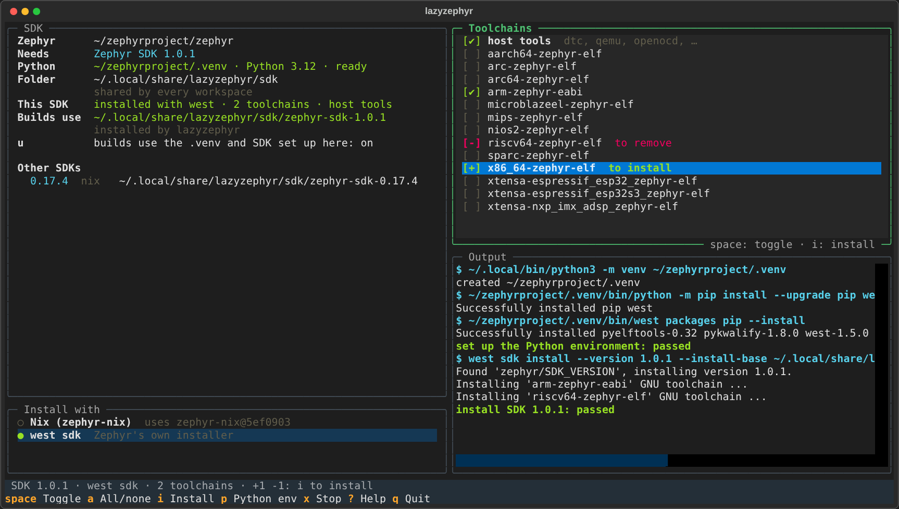
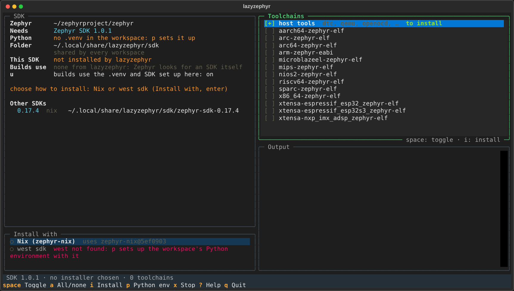

# SDK tab

Sets up what a build needs besides the code: the workspace's Python environment (`west`
and Zephyr's Python requirements) and the Zephyr SDK (the cross toolchains and host
tools) that the workspace's Zephyr asks for. lazyzephyr's builds and twister runs then
use both.



## What it shows

- **Needs**: the SDK version this Zephyr wants, from its `SDK_VERSION` file.
- **Python**: the workspace's `.venv`, and whether it has `west` and Zephyr's current
  requirements.
- **This SDK**: whether lazyzephyr has installed that version, how, and with which
  toolchains.
- **Builds use**: the SDK that builds started from lazyzephyr will use, and why (see
  [What builds use](#what-builds-use)).
- **Other SDKs**: other versions in lazyzephyr's folder, and SDKs installed elsewhere
  (`~/zephyr-sdk-*`, `/opt/zephyr-sdk-*` and the other places Zephyr looks).

## The Python environment

Zephyr's getting-started guide keeps a virtualenv in the west workspace, with `west` and
Zephyr's Python requirements in it. `p` sets that up:

1. creates `.venv` in the workspace (the folder with `.west`), with the Python lazyzephyr
   runs on (3.12 or later);
2. installs `west` into it;
3. runs `west packages pip --install`, which installs Zephyr's requirements and those of
   any modules that list some.



If the workspace already has a `.venv`, lazyzephyr asks first, then installs into that
one. When Zephyr's requirement files change (after a `west update` to a new Zephyr, say),
the tab says so, and `p` installs them again.

Then `west sdk` below, and the builds and twister runs started from lazyzephyr, run from
that `.venv`. A virtualenv you activated yourself before starting lazyzephyr wins.

## Installing the SDK

1. Pick how to install it in **Install with** (`enter`). lazyzephyr remembers the choice:
   - **Nix** builds the SDK with [zephyr-nix](https://github.com/nix-community/zephyr-nix).
     It needs `nix` on your `PATH`; flakes don't need to be turned on. zephyr-nix
     packages one version per SDK release line (0.16.9, 0.17.4 and 1.0.1 in the
     zephyr-nix lazyzephyr uses). If it doesn't have the exact version your Zephyr
     needs, the tab says so (see [Which zephyr-nix](#which-zephyr-nix)).
   - **west sdk** is Zephyr's own installer (`west sdk install`). It needs Zephyr 4.0 or
     later and `west`: the workspace's `.venv` (`p`), or one on your `PATH`.
2. Tick the toolchains you need with `space` (`a` for all or none). Most boards need
   one: `arm-zephyr-eabi` for Arm Cortex-M, `riscv64-zephyr-elf` for RISC-V,
   `x86_64-zephyr-elf` for `qemu_x86`. The **host tools** row adds the SDK's `dtc`, QEMU,
   OpenOCD and so on.
3. Press `i` to install. The output shows the installer's progress; `x` stops it.

Ticking or unticking toolchains later and pressing `i` again adds or removes just those.
With west sdk, removing asks first, then deletes those toolchains' folders. With Nix the
SDK is rebuilt with the new list. `D` removes the whole version from lazyzephyr's folder.

The toolchain list comes from the SDK release on GitHub. lazyzephyr only asks GitHub
once the tab is opened, and keeps the answer in `~/.cache/lazyzephyr/sdk-releases/`.

## Where SDKs are kept

One folder shared by every workspace, so two workspaces on the same Zephyr version share
one SDK:

```
~/.local/share/lazyzephyr/sdk/
  zephyr-sdk-1.0.1/          a folder (west sdk) or a link into the Nix store (Nix)
  zephyr-sdk-0.17.4/
  hosttools-1.0.1            Nix only: the host tools are a separate package there
  lazyzephyr-sdk.json        your choices in this tab
```

`$XDG_DATA_HOME` moves it with the rest of your data; `LAZYZEPHYR_SDK_DIR` moves just
this folder. The install script keeps lazyzephyr itself in `venv` in the folder above.
Updates only replace that, so the SDKs stay.

Nix keeps the SDK in its store and leaves a link here. The link also stops
`nix-collect-garbage` from deleting it; removing the SDK in the tab removes the link, and
the next garbage collection frees the space.

`west sdk install` also registers the SDK with CMake (in `~/.cmake/packages`), so plain
`west build` outside lazyzephyr finds it too. If west already knows an SDK of that
version somewhere else, it adds the toolchains there instead of installing a second copy;
the output says so.

## Which zephyr-nix

lazyzephyr uses a fixed zephyr-nix commit (shown next to Nix in **Install with**), so
an install never changes because zephyr-nix changed. New lazyzephyr releases move it
forward. For an SDK version that only a newer zephyr-nix has, set `zephyr_nix` in
`lazyzephyr-sdk.json` in the SDK folder to any flake reference, then press `r`:

```json
{
  "backend": "nix",
  "zephyr_nix": "github:nix-community/zephyr-nix"
}
```

`github:nix-community/zephyr-nix` follows its latest commit; add `/<commit>` to fix it.

## What builds use

Builds, flashing, menuconfig and twister runs started from lazyzephyr get:

- the workspace's `.venv` first on the `PATH` (and `VIRTUAL_ENV` set), if it has
  `west`. A virtualenv you activated yourself wins.
- `ZEPHYR_SDK_INSTALL_DIR` set to the SDK in lazyzephyr's folder that matches this
  workspace's Zephyr, if there is one. One you set yourself wins.
- with Nix's host tools, their `bin` folder first on the `PATH` too.

`u` turns all of this off; builds then find `west` and an SDK the way they would outside
lazyzephyr.

## Keys

| Key | Action |
| --- | --- |
| `p` | set up the workspace's Python environment, or update its requirements |
| `enter` (Install with) | use this way of installing |
| `space` / `a` | tick a toolchain or the host tools / all or none |
| `i` | install: apply the ticked changes |
| `D` | remove this SDK version from lazyzephyr's folder (asks first) |
| `u` | builds use the workspace's `.venv` and lazyzephyr's SDK: on/off |
| `r` | look again: installed SDKs, toolchain list, zephyr-nix's versions |
| `x` / `L` | stop the install / clear the output |
| `z` | maximize the focused panel |
| `?` | help |
